

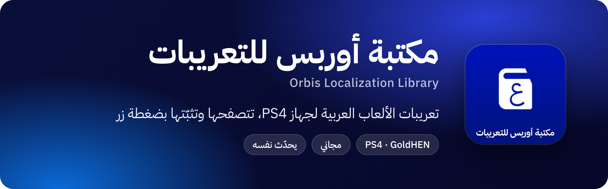

  

<a href="https://github.com/SajjadRahim/OLL/releases/latest">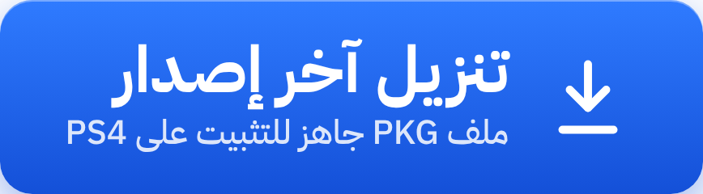</a>

 

**[صفحة كل الإصدارات](https://github.com/SajjadRahim/OLL/releases)** · **[حساب X](https://x.com/OLLPS4)** · **[قناة تيليجرام](https://t.me/OLLPS4)**

 

## ما هي مكتبة أوربس للتعريبات؟

تطبيق مجاني لأجهزة PS4 المعدّلة يجمع تعريبات الألعاب العربية في مكان واحد. تتصفح فيه كتالوجا يحدث باستمرار، وترى تفاصيل كل تعريب ولقطات من داخل اللعبة، ثم تنزله وتثبّته بضغطة زر، دون حاجة إلى حاسوب ودون تعديل أي ملف أصلي في اللعبة.

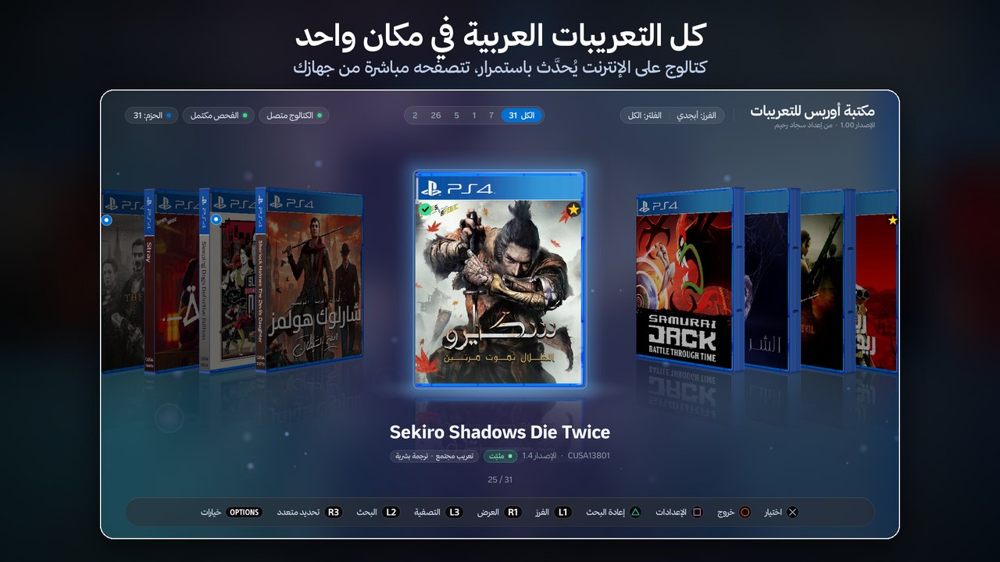

## المزايا

- **تنزيل وتثبيت بضغطة زر:** ملفات موقعة يتحقق منها قبل التثبيت.
- **كتالوج على الإنترنت:** كل التعريبات العربية المتاحة، يحدث باستمرار.
- **يتعرّف على ألعابك:** يكتشف الألعاب المثبتة على جهازك ويعرض تعريباتها أولًا.
- **تفاصيل كاملة قبل التثبيت:** فريق العمل، ونوع التعريب، والحجم، والتوافق مع تحديث لعبتك.
- **لقطات من داخل اللعبة:** شاهد التعريب قبل تثبيته.
- **أكثر من تعريب للعبة الواحدة:** فرق مختلفة، وتعريب بشري أو آلي، ولكل تحديث تعريبه.
- **تنبيه عند اختلاف التحديث:** يقارن إصدار لعبتك بالإصدار الذي أُعد له التعريب.
- **تثبيت عدة تعريبات دفعة واحدة.**
- **إدارة التعريبات المثبتة:** حجم كل تعريب، والمساحة المتبقية، وحذف الجميع بضغطة.
- **فحص وإصلاح:** يتحقق من كل ملف مثبت ويصلح المشكلات.
- **نسخ إلى USB ونسخ احتياطي:** احفظ تعريباتك حزمًا كاملة واستعدها متى شئت، دون إنترنت.
- **ست طرق لعرض المكتبة**، وثيمان فاتح وداكن، وثمانية ألوان، وعدة خطوط عربية.
- **يحدّث نفسه:** ينزل الإصدار الجديد ويتحقق من توقيعه، ويعرض لك ما الجديد فيه.

## لقطات من التطبيق

<table>
<tr>
<td width="50%">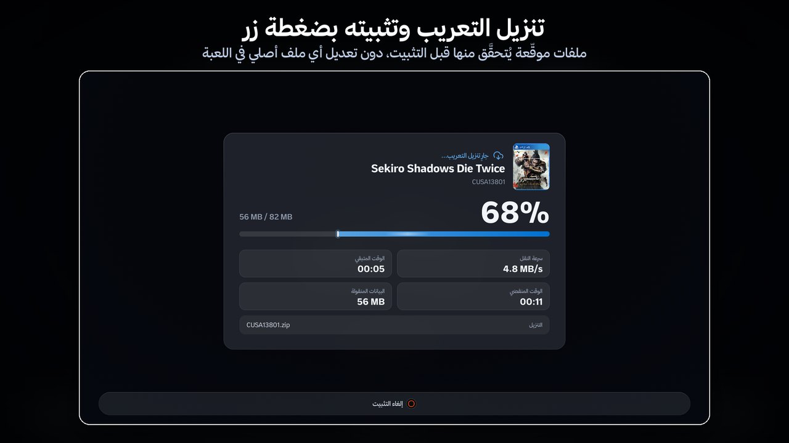</td>
<td width="50%">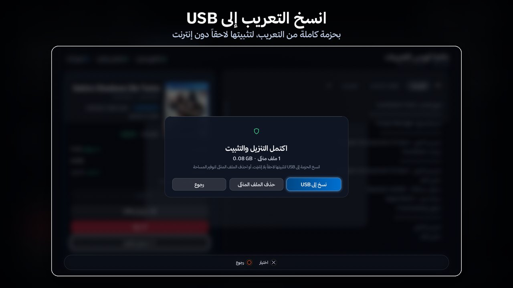</td>
</tr>
<tr>
<td>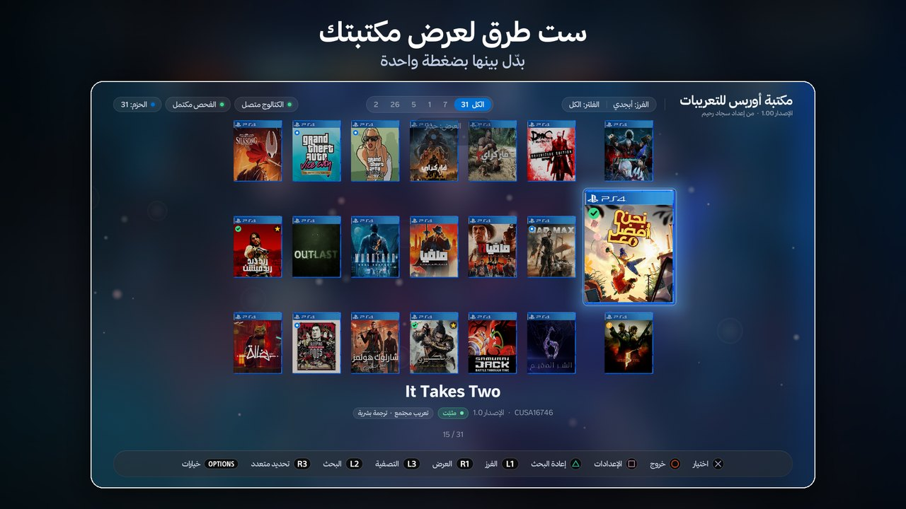</td>
<td>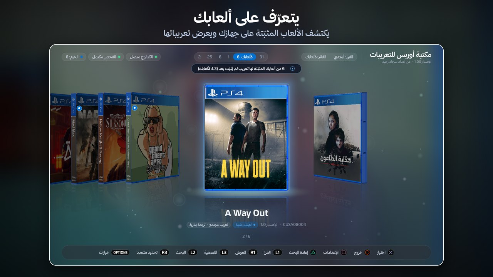</td>
</tr>
<tr>
<td>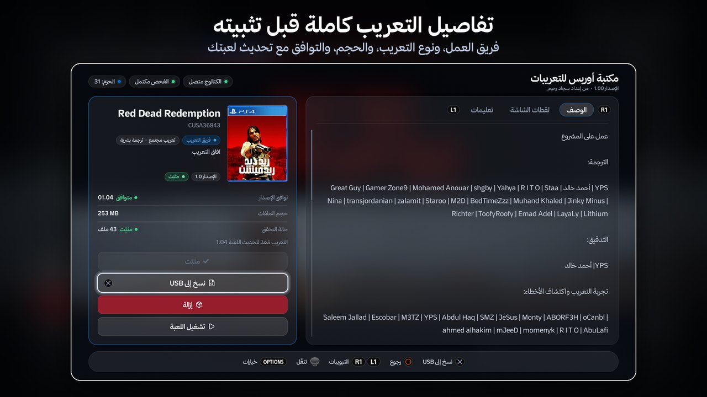</td>
<td>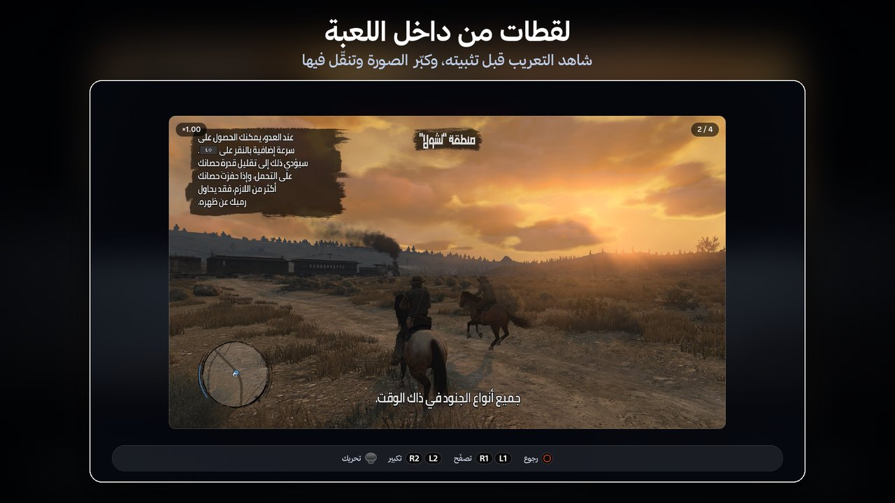</td>
</tr>
<tr>
<td>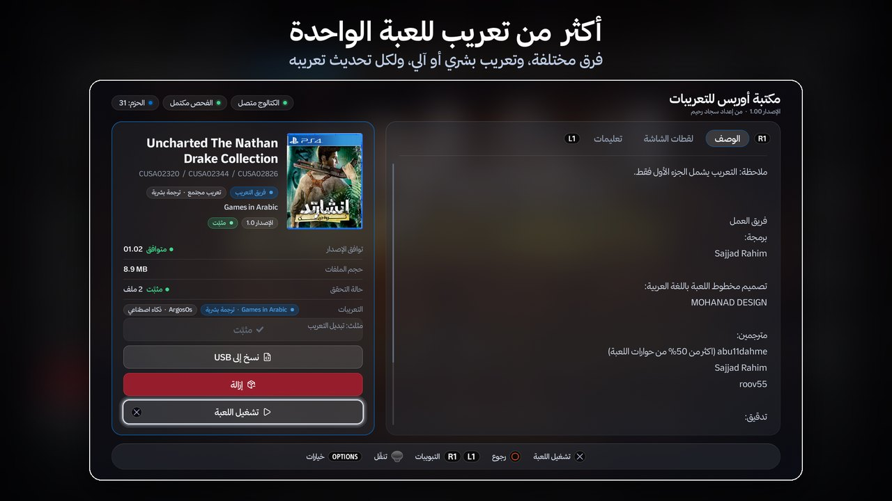</td>
<td>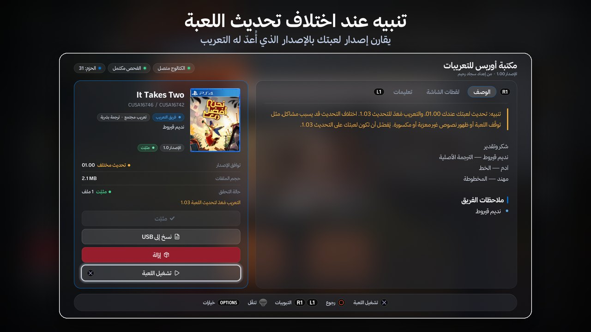</td>
</tr>
<tr>
<td>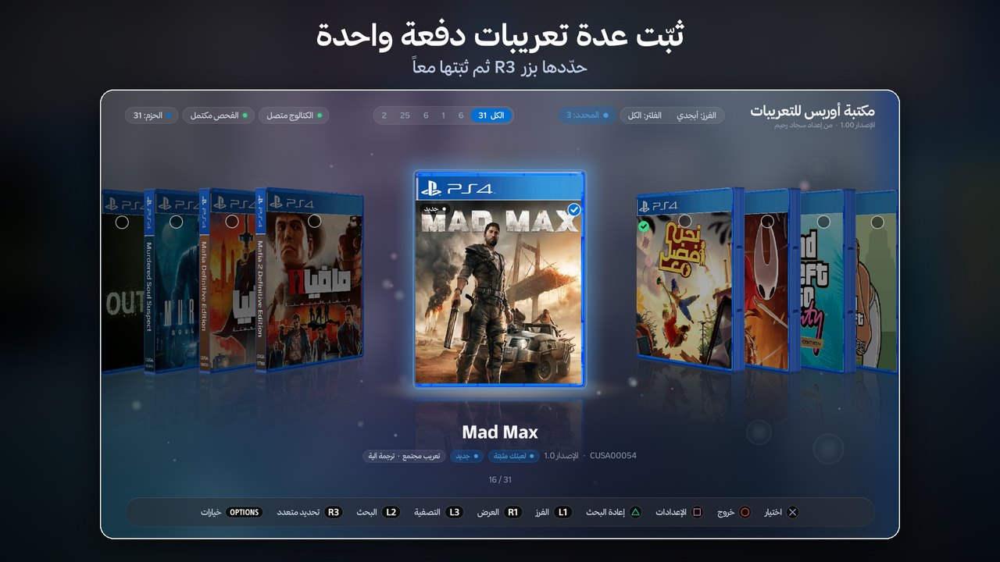</td>
<td>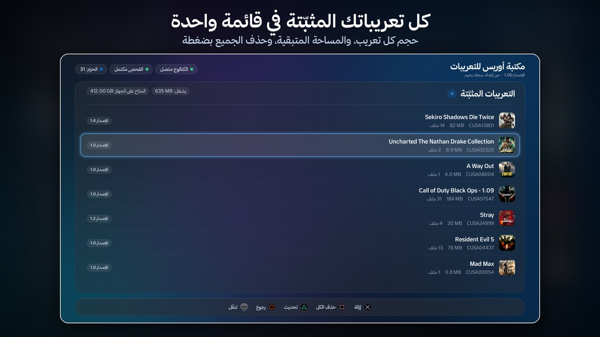</td>
</tr>
<tr>
<td>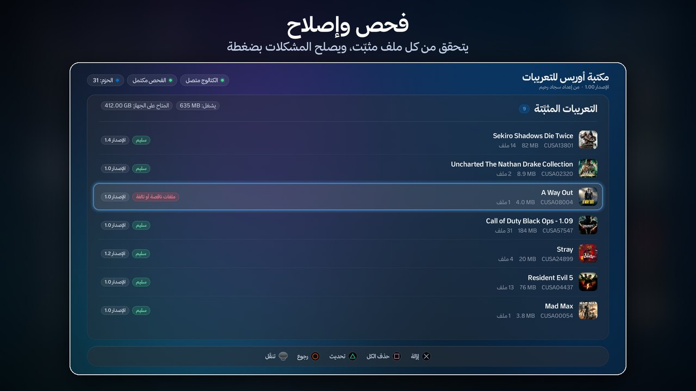</td>
<td>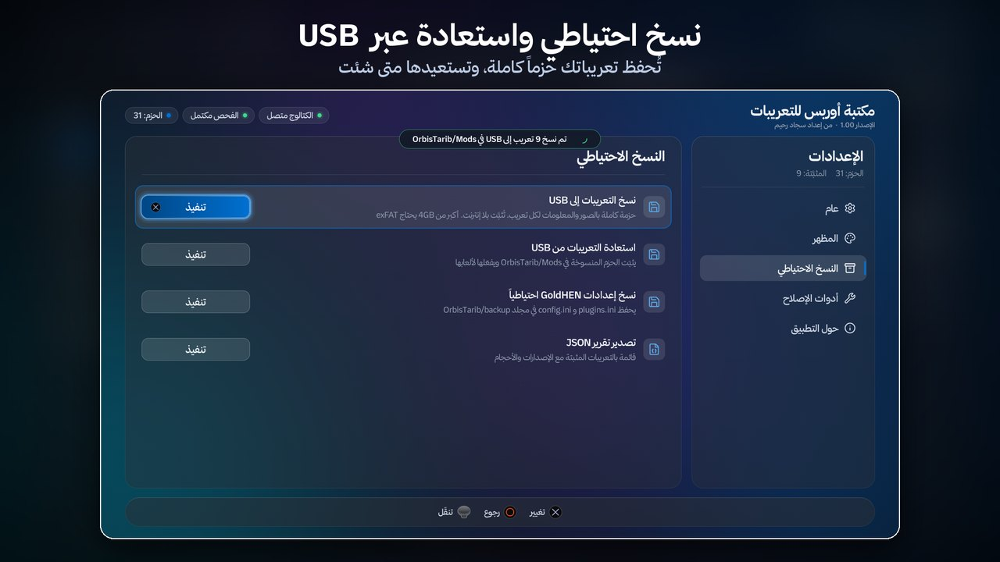</td>
</tr>
<tr>
<td>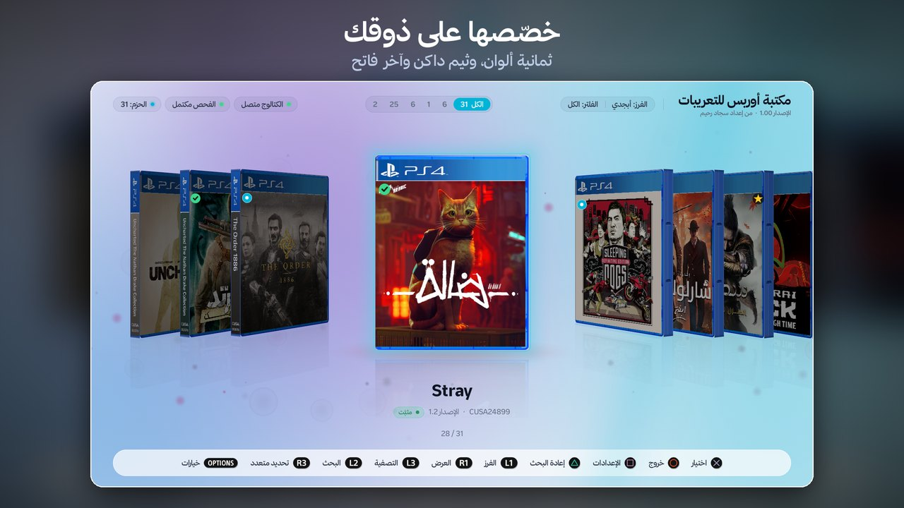</td>
<td>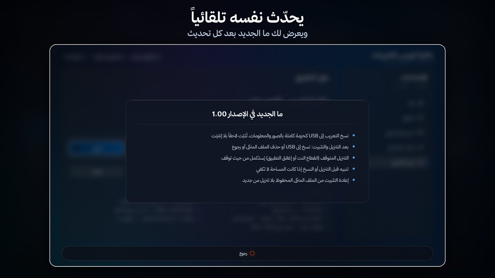</td>
</tr>
</table>

## المتطلبات

- جهاز PS4 معدل وعليه **GoldHEN**.
- اتصال بالإنترنت لتصفح التعريبات وتنزيلها، أو فلاشة USB فيها حزم التعريبات.

## التثبيت

1. اضغط زر **تنزيل آخر إصدار** في الأعلى، ونزل ملف `OLL-x.xx.pkg` من صفحة الإصدار.
2. انسخ الملف إلى فلاشة USB، أو إلى المجلد `‎/data/pkg` على الجهاز.
3. ثبّته من **Debug Settings ← Package Installer** في GoldHEN، أو بأي أداة لتثبيت ملفات PKG.
4. شغّل **مكتبة أوربس للتعريبات** من الشاشة الرئيسية.

## التحديث

لا حاجة إلى العودة إلى هذه الصفحة بعد التثبيت الأول. افتح **الإعدادات ← حول التطبيق ← تحديث التطبيق**، فينزل التطبيق الإصدار الجديد ويتحقق من توقيعه ويحفظه في `‎/data/pkg`، ثم ثبّته من Package Installer.

> ملف `update.json` في صفحة كل إصدار هو ملف التحديث الموقع الذي يقرؤه التطبيق، ولا حاجة إلى تنزيله.

## تواصل معنا

تابع آخر التعريبات والإصدارات، وأبلغ عن أي مشكلة:

- **X:** [@OLLPS4](https://x.com/OLLPS4)
- **تيليجرام:** [t.me/OLLPS4](https://t.me/OLLPS4)

 

من إعداد <b>سجاد رحيم</b>

